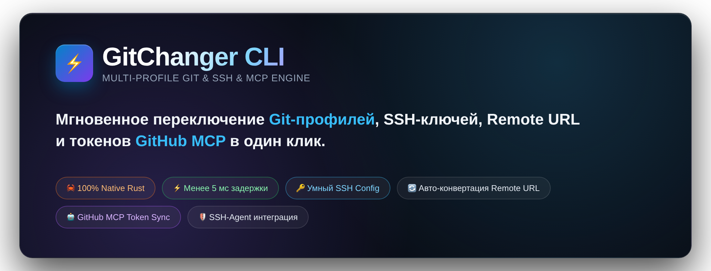
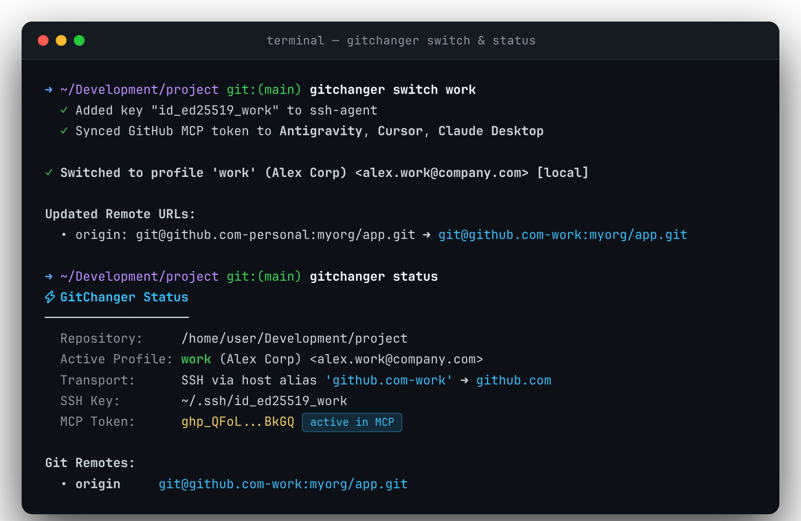
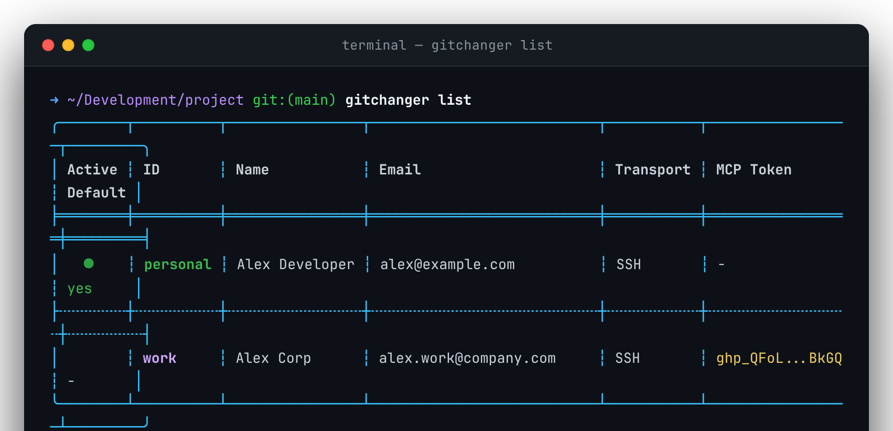
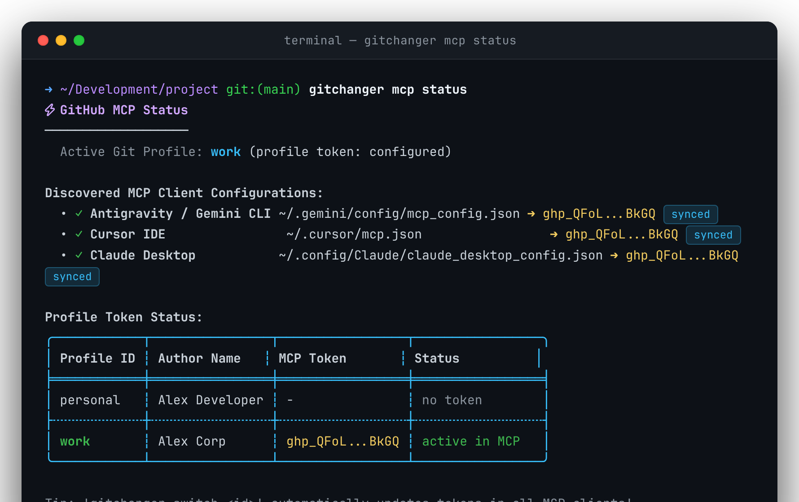
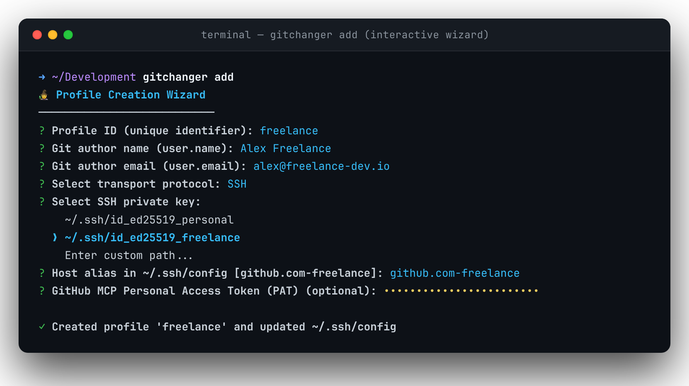
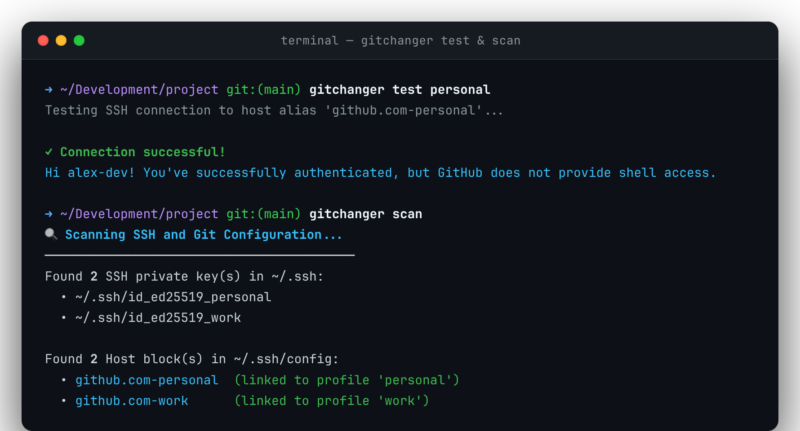
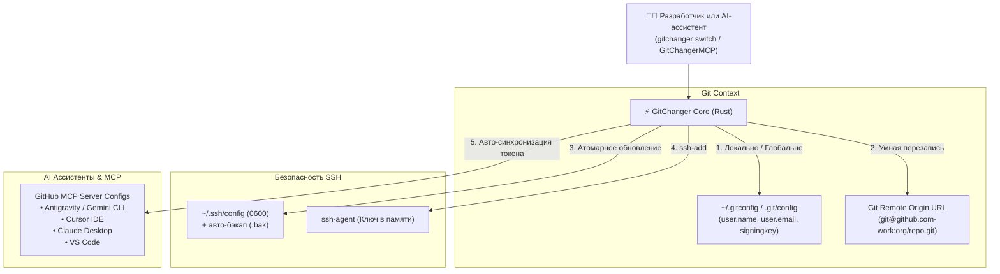

<div align="center">

<a href="https://github.com/culcat/GitChangerCLI">
  
</a>

# GitChanger CLI ⚡

**Молниеносный нативный CLI-менеджер профилей Git, SSH-ключей и токенов GitHub MCP для AI-ассистентов.**

[](https://www.rust-lang.org)
[](https://github.com/culcat/GitChangerCLI)
[](LICENSE)
[](https://github.com/culcat/GitChangerCLI)
[](https://github.com/culcat/GitChangerMCP)
[](#)

[Возможности](#-ключевые-возможности) • [Зачем нужен?](#-зачем-нужен-gitchanger) • [Установка](#-установка) • [Быстрый старт](#-быстрый-старт) • [MCP Server](#-официальный-mcp-сервер-gitchangermcp) • [Справочник](#-полный-справочник-команд) • [Конфигурация](#️-конфигурация)

---



</div>

## 💡 Зачем нужен GitChanger?

Если вы используете **несколько аккаунтов на GitHub, GitLab или Bitbucket** (например, личный, рабочий и пет-проекты) — вы наверняка сталкивались с этими проблемами:

| Типичная проблема разработчика | Как её решает GitChanger ⚡ |
|---|---|
| ❌ Случайно запушил коммит с рабочего email в личный репозиторий (или наоборот). | ✅ Мгновенное переключение `user.name`, `user.email` и `user.signingkey` локально или глобально. |
| ❌ Ошибка `Permission denied (publickey)` при `git push` из-за неправильного SSH-ключа. | ✅ Авто-конфигурация `~/.ssh/config` и автоматическая загрузка нужного ключа в `ssh-agent`. |
| ❌ Приходится помнить хост-алиасы и вручную переписывать `git@github.com-work:user/repo.git`. | ✅ Автоматическая перезапись Remote URL (`origin`) при смене профиля. |
| ❌ AI-ассистенты (Antigravity, Cursor, Claude Desktop) путают аккаунты из-за одного общего MCP токена. | ✅ **Первый в мире** авто-переключатель GitHub Personal Access Token в конфигурациях MCP-клиентов! |

---

## ⚡ Ключевые возможности

- 🚀 **100% Native Rust & Zero Latency**: Молниеносное выполнение (до 5 мс), минимальное потребление ресурсов и никаких сторонних рантаймов (Node.js/Python).
- 🔄 **Умная перезапись Git Remote URL**:
  - `https://github.com/org/repo.git` ➔ `git@github.com-work:org/repo.git`
  - Автоматически синхронизирует хост-алиасы в зависимости от выбранного транспорта.
- 🔑 **Авто-менеджмент `~/.ssh/config`**:
  - Создаёт и изолирует блоки `Host` (`HostName`, `User`, `IdentityFile`, `IdentitiesOnly yes`).
  - Создаёт бэкап `~/.ssh/config.bak` перед каждым изменением.
  - Устанавливает строгие права доступа `0600`.
- 🛡️ **Интеграция с `ssh-agent`**:
  - Авто-старт агента и безопасная подгрузка ключей через `ssh-add`.
  - Встроенный тест сетевого SSH-соединения (`gitchanger test`).
- 🤖 **Синхронизация токенов GitHub MCP**:
  - Привязывайте GitHub PAT к каждому профилю.
  - Авто-обновление токена в конфигурациях **Google Antigravity / Gemini CLI**, **Cursor IDE**, **Claude Desktop** и **VS Code** при смене активного профиля!
- 🔌 **Официальный MCP-сервер для AI**:
  - Управляйте GitChanger прямо из диалога с AI через [GitChangerMCP](https://github.com/culcat/GitChangerMCP).
- 🎨 **Интерактивный TUI и CLI режимы**:
  - Пошаговый мастер создания профилей с автопоиском ключей в `~/.ssh/`.
  - Интерактивное меню выбора профиля стрелочками.
  - Полноценный флаг-интерфейс для скриптов и dotfiles.
- 🔌 **Поддержка Git Subcommand**:
  - Запускайте привычно: `git changer switch`, `git changer status`.

---

## 🖼️ Демонстрация

### 📋 Список профилей (`gitchanger list`)
Информативная и компактная таблица с индикацией активного профиля, транспорта, маскированных MCP-токенов и профиля по умолчанию:

<div align="center">
  
</div>

---

### 🤖 GitHub MCP статус (`gitchanger mcp status`)
Отслеживание синхронизации токенов GitHub MCP между всеми установленными AI-клиентами:

<div align="center">
  
</div>

---

### 🧙 Пошаговый интерактивный мастер (`gitchanger add`)
Автоматический поиск доступных SSH-ключей, валидация полей и мгновенное создание алиаса:

<div align="center">
  
</div>

---

### 🔍 Диагностика и проверка связи (`test` & `scan`)
Сканирование имеющихся настроек SSH и верификация соединения с GitHub:

<div align="center">
  
</div>

---

## 🤖 Официальный MCP сервер: GitChangerMCP

Для полноценной интеграции с современными AI-ассистентами разработан официальный сервер:
👉 **[GitChangerMCP](https://github.com/culcat/GitChangerMCP)** — Model Context Protocol сервер для GitChanger.

Он позволяет **Google Antigravity / Gemini CLI**, **Claude Desktop**, **Cursor IDE**, **VS Code (Roo Code / Cline)**:
1. Читать текущую Git-идентичность и активный репозиторий (`gitchanger_status`).
2. Автоматически переключать Git-аккаунты прямо во время выполнения задач (`gitchanger_switch`).
3. Тестировать SSH-подключения и управлять GitHub PAT токенами для `@modelcontextprotocol/server-github`.

```json
// Пример подключения в mcp_config.json / claude_desktop_config.json:
{
  "mcpServers": {
    "gitchanger": {
      "command": "node",
      "args": ["/path/to/GitChangerMCP/dist/index.js"]
    }
  }
}
```

Подробнее о настройке читайте в репозитории [GitChangerMCP](https://github.com/culcat/GitChangerMCP).

---

## 🏗️ Архитектура работы



---

## 📦 Установка

### Вариант 1: Из исходников (через Cargo)

```bash
git clone https://github.com/culcat/GitChangerCLI.git
cd GitChangerCLI
cargo install --path .
```

Убедитесь, что директория `~/.cargo/bin` находится в вашей переменной `$PATH`:
```bash
export PATH="$HOME/.cargo/bin:$PATH"
```

### Вариант 2: Запуск как подкоманды `git changer`

Создайте символическую ссылку на исполняемый файл:

```bash
ln -s $(which gitchanger) ~/.cargo/bin/git-changer
```

Теперь утилита доступна как родная подкоманда Git:
```bash
git changer status
git changer switch
```

---

## 🚀 Быстрый старт

### 1. Интерактивный запуск без параметров
Если вы находитесь внутри репозитория, простой запуск `gitchanger` сразу откроет интерактивное меню переключения профилей:
```bash
gitchanger
```

### 2. Добавление профилей
```bash
# Интерактивный диалог с автопоиском ключей в ~/.ssh
gitchanger add

# Или неинтерактивно одной командой:
gitchanger add --id work \
  --name "Alex Corp" \
  --email "alex.work@company.com" \
  --transport ssh \
  --key ~/.ssh/id_ed25519_work \
  --alias github.com-work \
  --token ghp_YourGitHubPAT \
  --non-interactive
```

### 3. Переключение профиля
```bash
# Переключить для текущего репозитория (локально)
gitchanger switch work

# Переключить глобально в ~/.gitconfig
gitchanger switch work --global

# Переключить и сразу проверить SSH-соединение
gitchanger switch work -t
```

### 4. Просмотр текущего статуса
```bash
gitchanger status

# Подробная системная диагностика (ssh-agent, пути к файлам):
gitchanger status -v
```

---

## 🤖 Синхронизация токенов GitHub MCP

GitChanger — первый инструмент, нативно поддерживающий управление токенами для **GitHub MCP Server** (`@modelcontextprotocol/server-github`).

Когда вы переключаетесь с личного проекта на рабочий, AI-ассистенты должны использовать соответствующий Personal Access Token, чтобы иметь доступ к приватным репозиториям и issue нужной организации.

### Поддерживаемые AI-клиенты:
- **Google Antigravity / Gemini CLI** (`~/.gemini/config/mcp_config.json`)
- **Cursor IDE** (`~/.cursor/mcp.json`)
- **Claude Desktop** (`~/.config/Claude/claude_desktop_config.json`)
- **VS Code** (`~/.vscode/mcp.json` / workspace settings)

### Команды управления MCP:
```bash
# Посмотреть статус токенов во всех клиентах
gitchanger mcp status

# Привязать токен к профилю (с маскированием ввода)
gitchanger mcp set work

# Проверить токен через официальный GitHub API (логин, скоупы, лимиты)
gitchanger mcp test work

# Принудительно синхронизировать токен профиля в MCP-файлы
gitchanger mcp sync work

# Безопасный просмотр (маскированный / полный для экспорта в переменные)
gitchanger mcp get work
gitchanger mcp get work --unmask
```

> [!TIP]
> При выполнении `gitchanger switch <id>` токен синхронизируется в MCP автоматически! Если вы не хотите обновлять MCP при переключении, используйте флаг `--no-mcp`.

---

## 📖 Полный справочник команд

<details>
<summary><b>🔍 Нажмите, чтобы развернуть таблицу всех команд и флагов</b></summary>

| Команда | Алиасы | Описание | Примеры использования |
|---|---|---|---|
| `status` | `current`, `whoami` | Отображает активный профиль репозитория, origin URL и токен | `gitchanger status`<br>`gitchanger status -v` |
| `list` | `ls` | Таблица всех сконфигурированных профилей | `gitchanger list`<br>`gitchanger list -v` |
| `switch [ID]` | `use` | Переключение активного профиля | `gitchanger switch`<br>`gitchanger switch work -g` |
| `add` | `new`, `create` | Добавление нового профиля (TUI / флаги) | `gitchanger add` |
| `edit [ID]` | - | Редактирование существующего профиля | `gitchanger edit personal` |
| `delete <ID>` | `rm`, `remove` | Удаление профиля (и очистка SSH Host блока) | `gitchanger delete old_work` |
| `default <ID>` | - | Назначение профиля по умолчанию | `gitchanger default personal` |
| `test [ID]` | - | Тестирование SSH-подключения к хосту | `gitchanger test work` |
| `scan` | - | Сканирование системы на ключи, хосты и MCP | `gitchanger scan` |
| `mcp` | `token`, `tokens` | Управление токенами GitHub MCP | `gitchanger mcp status` |
| `export [FILE]` | - | Экспорт конфигурации в JSON или stdout | `gitchanger export backup.json` |
| `import <FILE>` | - | Импорт профилей из бэкапа | `gitchanger import backup.json --force` |

### Флаги команды `switch`:
- `-g, --global` — применить изменения глобально в `~/.gitconfig` (по умолчанию: локально в `.git/config`).
- `--no-remote-update` — не изменять Remote URL репозитория.
- `--no-ssh-agent` — не добавлять ключ в ssh-agent.
- `--no-mcp` — не обновлять токен в конфигурациях MCP.
- `-t, --test` — запустить сетевой тест SSH после переключения.

</details>

---

## ⚙️ Конфигурация

Файл конфигурации хранится в стандартном каталоге XDG:
`~/.config/gitchanger/config.toml`

```toml
# Пример конфигурации ~/.config/gitchanger/config.toml

[[profiles]]
id = "personal"
name = "Alex Developer"
email = "alex@example.com"
transport = "ssh"
ssh_host_alias = "github.com-personal"
ssh_host_name = "github.com"
ssh_key_path = "~/.ssh/id_ed25519_personal"
github_token = "ghp_PersonalPAT..."
use_ssh_agent = true
is_default = true

[[profiles]]
id = "work"
name = "Alex Corp"
email = "alex.work@company.com"
transport = "ssh"
ssh_host_alias = "github.com-work"
ssh_host_name = "github.com"
ssh_key_path = "~/.ssh/id_ed25519_work"
github_token = "ghp_WorkPAT..."
use_ssh_agent = true
is_default = false
```

---

## 🔒 Безопасность и надёжность

> [!IMPORTANT]
> GitChanger следует строгим стандартам безопасности Unix:

- **Никаких секретов в открытом виде**: Токены в терминале всегда маскируются (`ghp_QFoL...BkGQ`) во всех командах (`status`, `list`, `scan`, `mcp`). Открытый вывод возможен исключительно при явном указании флага `--unmask`.
- **Приватные ключи не читаются**: Утилита оперирует исключительно путями к ключам и никогда не читает их секретное содержимое.
- **Атомарная запись**: Все операции записи файлов конфигурации производятся через атомарную замену временных файлов, исключая повреждение настроек при внезапном сбое.
- **Автоматические резервные копии**: При любых изменениях файлов `~/.ssh/config` и конфигов MCP создаются `.bak` бэкапы.
- **Строгие права доступа**: Файл `~/.ssh/config` автоматически защищается правами `0600` (чтение/запись только владельцем).

---

## 🤝 Вклад в проект

Пуллреквесты и предложения приветствуются!
1. Форкните репозиторий: [github.com/culcat/GitChangerCLI](https://github.com/culcat/GitChangerCLI)
2. Создайте ветку для фичи: `git checkout -b feature/amazing-feature`
3. Зафиксируйте изменения: `git commit -m 'feat: Add amazing feature'`
4. Отправьте в ветку: `git push origin feature/amazing-feature`
5. Откройте Pull Request.

---

## 📄 Лицензия

Проект распространяется под лицензией [MIT](LICENSE).

<div align="center">
  <sub>Разработано с ❤️ автором <a href="https://github.com/culcat">culcat</a></sub>
</div>
